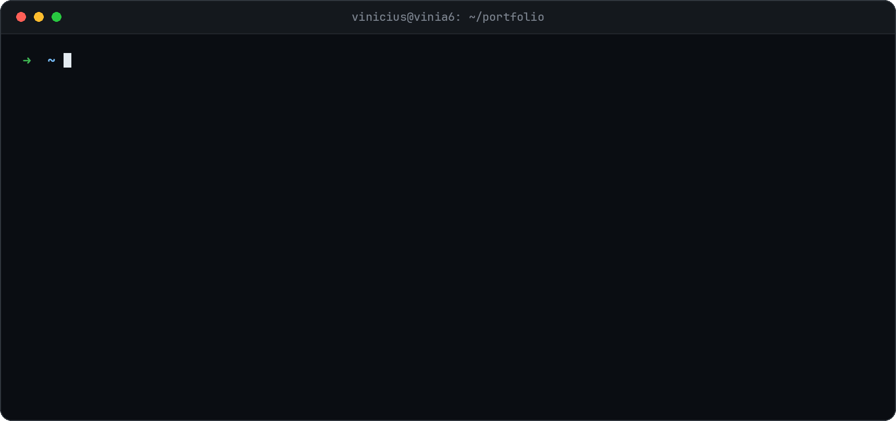

<p align="center">
  
</p>

<p align="center">
  
</p>

<p align="center">
  <a href="https://www.linkedin.com/in/vinia6/"></a>
  &nbsp;
  <a href="https://www.instagram.com/viniciusdeassisazevedo/"></a>
</p>

<details>
<summary><b><code>$ cat CHANGELOG.md</code></b>&nbsp; <sub>👀 clica aqui</sub></summary>
<br />

```diff
@@ v2.0.0-beta · em construção @@

- 20 projetos de faculdade num grid de pastinhas
- lista de tecnologias que todo mundo tem
- banner estático
+ menos crud, mais ia
+ projetos que contam uma história
+ deploy de verdade (em breve)

  café: dependência crítica, não remover
```

</details>

<br />

<p align="center">
  
</p>
